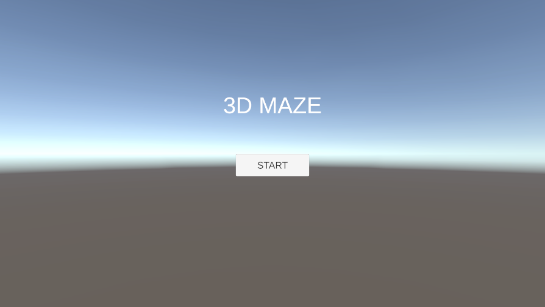
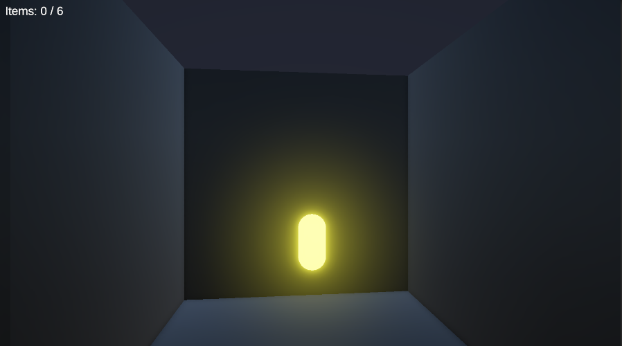
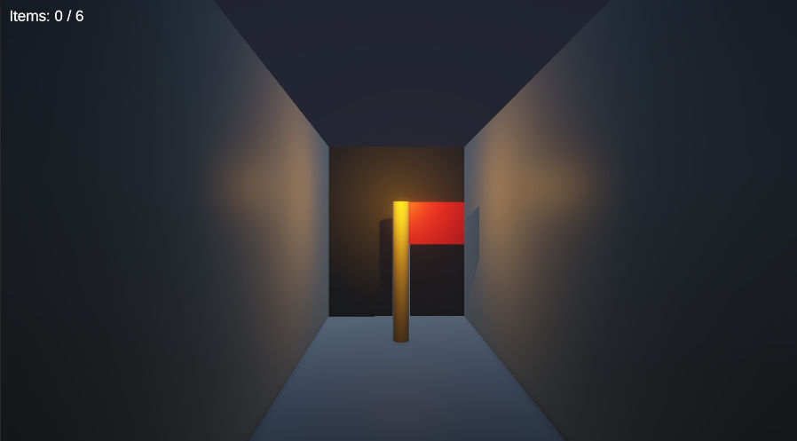

# 3D MAZE

暗い迷路でアイテムを回収しながらゴールを目指すゲーム

## プレイ動画

https://github.com/user-attachments/assets/be965582-fd51-4055-9aa8-f4e97e5b1877

## スクリーンショット

## 概要

プレイヤーを操作して暗いステージ内に配置されたアイテムを回収しゴールを目指す。すべてのアイテムを集めるまではゴールできず、すべて回収するとクリアできるようになる。

## 遊び方

- W・S：前進・後退
- A・D：向きを変える
- Space：ジャンプ

1. タイトル画面からゲームを開始
2. ステージ内のすべてのアイテムを回収
3. 移動する障害物を避けながらゴールへ
4. ゴールに到達するとクリア画面へ移動

## 主な機能

- プレイヤー：移動、向きの変更、ジャンプ、アニメーション（待機・歩き・ジャンプ）
- アイテム：回収、個数の表示、回収時の演出（効果音、パーティクル）
- 障害物：転がる岩と、一定範囲を往復する低い障害物。接触時はスタート地点へ戻される仕組み
- ゴール：全アイテム回収で条件達成。クリア音のあとクリア画面へ移動。未達成のときはメッセージを表示
- 画面：タイトル、クリア、リトライ
- 演出：光るアイテム、ゴールを照らすライト
- 効果音：ジャンプ、アイテム回収、障害物との衝突、スタート地点へのワープ、クリア

## 工夫した点

### 1. ステージの色と光による目線の誘導

暗い迷路の中で、プレイヤーが自然にゴールとアイテムに気づけるよう、色と光で目線を誘導した。まず環境光を弱めてステージ全体を暗くし、明るい空に目線が引っぱられないよう、カメラの背景も暗い紺色にした。暗い中でも通路の形が分かるよう、壁は青みのある黒、床は青みのあるグレーにして、明るさに差をつけた。そのうえで、ゴールには暖色の Point Light を置いた。寒色の暗いステージとの対比で目立たせるだけでなく、緊張感のある迷路を抜けた先で、暖かい光に迎えられる安心感を感じられるよう意図した。また、光が壁をすり抜けて隣の通路を照らさないよう、影を有効にした。アイテムは Emission で発光させ、Bloom で光をにじませることでアイテム自身が光っているように見えるようにした。

色や明るさは好みではなく、「通路の形が分かるか」「ゴールとアイテムが一番目立つか」「目立たせたくない所が目立っていないか」の3つを基準に、ゲーム画面で確認しながら決めた。その結果、暗いステージの中でもゴールとアイテムに自然と目が向く画面になった。

### 2. 状況に応じた効果音の鳴らし方の使い分け

音が途中で途切れたり、何が起きたか分かりにくくなったりしないよう、場面ごとに効果音の鳴らし方を変えた。アイテムは触れた瞬間に非表示にするが、アイテムについたスピーカーで鳴らすと、非表示と同時に音も止まってしまう。そこで、アイテムとは別に一時的なスピーカーを作って鳴らす `PlayClipAtPoint` を使った。ゴールでは、シーンの切り替えでスピーカーごと消えてしまうため、クリア音を鳴らしてから約1秒待って、クリア画面へ移るようにした。リスポーンでは、衝突音とワープ音がほぼ同時に鳴って聞き取りにくかったため、間に0.15秒の時間差をつけ、「当たった」「戻された」の2つの出来事が伝わるようにした。

### 3. 遊びながら確認し、原因を考えて直す進め方

実際に遊んで気になった動きを見つけ、原因を考えてから直し方を選ぶようにした。主な例は次の3つ。

- **壁に押し続けるとプレイヤーが回転する**：物理衝突で X・Z 方向にも回転していたため、Rigidbody の Freeze Rotation で X・Z の回転を固定
- **キャラクターモデル導入後、触れているのにアイテムを回収できない**：見た目だけ大きくなり、Collider が届いていなかったため、Collider の大きさと位置を調整。あわせて、処理を担当する `Player` と、見た目と Animator を担当するモデルのオブジェクトを分離
- **ゴールの条件を満たしていないときのメッセージが、ゴールから離れても消えない**：「離れたら消す」と「数秒たったら消す」を比較。表示の直後に消す行を書くと画面に映らず、時間で消す方法は何度も触れると待ち時間が重なるため、ゴールから離れたときに動く `OnTriggerExit` で、プレイヤーか確認してから消す方法を選択

## 使用技術

**ツール・言語**

- Unity 6.3
- Universal Render Pipeline
- C#

**操作・動き**

- Input System：移動・向きの変更・ジャンプのキー入力の受け取り
- Rigidbody：ジャンプの力と重力の処理、リスポーン時の移動と回転の勢いの停止
- Collider：アイテム・ゴールへの接触と、障害物・地面との衝突の判定

**アニメーション**

- Animator：移動中かどうか（Bool）とジャンプの合図（Trigger）による、待機・歩き・ジャンプの切り替え

**ゲームの流れ**

- SceneManager：タイトル・ゲーム・クリアの画面の切り替え
- コルーチン：クリア音のあとの画面切り替えと、リスポーン時の音の間の待ち時間
- UI Button：スタートとリトライの操作
- TextMeshPro：アイテムの回収数とメッセージの表示

**演出**

- AudioSource：場面ごとの効果音の再生
- Light（Point Light）：ゴールの照明
- Material（Emission）：アイテムの発光
- Volume（Bloom）：発光のにじみ
- Particle System：回収時のパーティクルの表示

## 制作について

### 制作の経緯

授業の課題として個人で制作し、その後も時間を見つけて段階的に機能を追加した。

- **2026年7月（1週間）**：授業の最終課題（自由制作）として、ステージ・移動・アイテム回収・障害物・ゴール・タイトル／クリア画面までの基本を制作
- **2026年8月**：キャラクターのアニメーションと効果音を追加
- **2026年10月**：ライトとマテリアル、パーティクルによる演出を追加。すべての処理を見直し、遊んで見つけた不具合を修正

### 制作の進め方

- **自分で考えて決めたこと**：ゲームの構成、ステージの配置、ゴールの条件（全アイテム回収）、画面の流れ、入れたい機能やギミックのアイデア、演出の方針（暗いステージで、光によってゴールとアイテムへ目線を誘導）
- **学んだ内容をもとに自分で書いたこと**：プレイヤーの移動、カメラの追従、基本のアイテム回収、基本のゴール判定、シーンの切り替え。授業と、Unity Learn の Junior Programmer コース（Unit 2 まで受講）で学んだ内容をもとに実装。AIにコードの確認と修正を依頼
- **Unity上で自分で行ったこと**：オブジェクトの配置とコンポーネントの設定、Animator のステートと遷移条件の設定、ライト・マテリアル・Bloom の数値の調整、ボタンとシーンの設定、遊びながらの動作確認
- **AIに質問しながら実装したこと**：考えたギミックや機能のコードの書き方と、エラーの意味をAIに確認。組み込みと対処は自分で実施
- **理解のためにやったこと**：すべての処理の流れを、コードに印をつけながら書き出し、自分の言葉で説明できるように整理。予想と違う動きがあったときは、設定を変えて原因を確認

## スクリプト一覧

| スクリプト | ついているオブジェクト | 役割 |
|---|---|---|
| TitleSceneController | TitleSceneManager | スタートボタンでのゲーム画面への切り替え |
| PlayController | Player | キー入力による移動・回転・ジャンプ、接地の判定、アニメーションの切り替え、ジャンプの効果音 |
| PlayerRespawn | Player | 障害物に当たったときのリスポーン（勢いの停止、衝突音、スタート地点へのワープ、ワープ音） |
| FollowPlayer | Main Camera | プレイヤーの位置と向きに合わせたカメラの追従 |
| ItemController | 各アイテム | プレイヤーとの接触の判定、GameManager への回収の通知、効果音とパーティクルの再生、アイテムの非表示 |
| GameManager | GameManager | アイテムの回収数の管理と表示、全回収の判定、メッセージの表示 |
| Hazard | RollingRock、MovingObstacle | プレイヤーとの衝突の判定、PlayerRespawn へのリスポーンの依頼 |
| MoveBetweenPoints | RollingRock、MovingObstacle | 2点間の往復移動。岩は移動方向に合わせて見た目を回転 |
| GoalController | Goal | ゴール条件の判定、条件未達成時のメッセージの表示と消去、クリア音のあとのクリア画面への切り替え |
| ClearSceneController | ClearSceneManager | リトライボタンでのゲーム画面への切り替え |

## 使用素材

- 効果音：効果音ラボ
- アニメーション：Mixamo
- キャラクター：Unity Asset Store（Low Poly Character Pack）

※利用規約により、素材ファイルはこのリポジトリに含めていない

## 今後の課題

- **視点の見直し**：一人称視点のため、待機・歩き・ジャンプのアニメーションが画面に映らない状態。三人称視点への変更や、視点の切り替えを検討
- **画面の雰囲気の統一**：ゲーム画面は暗い迷路だが、タイトル画面とクリア画面は明るい空のまま。作品全体の雰囲気の統一を検討
- **自分で実装できる範囲を広げる**：今回は多くのコードをAIに質問しながら実装。次の LBE・XR 寄りの作品では、処理の流れを自分で設計してからコードを書き、AIは確認やエラーの調査に使う進め方へ変更予定
